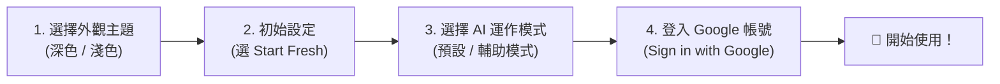

# Google Antigravity 桌機版安裝教學（新手零基礎指南）

> **適用對象**：完全沒有程式背景或第一次接觸 AI 開發工具的一般初學者  
> **支援系統**：Windows 電腦、macOS 蘋果電腦（MacBook / iMac / Mac mini）

---

## 一、安裝前準備（只需 1 分鐘）

在開始下載與安裝之前，請先確認以下兩件事：

1. **一台電腦（Windows 或 Mac 蘋果電腦）**
   - 💡 *貼心提醒：Antigravity 桌機版是專為電腦設計的軟體，無法直接安裝在 iPhone 或 iPad（iOS 系統）上喔！*
2. **一個個人的 Google 帳號（`@gmail.com`）**
   - 首次啟動軟體時需要登入 Google 帳號。
   - **新手強烈建議**：請準備**個人一般 Gmail 帳號**（例如 `xxx@gmail.com`）。公司或學校發配的 Google Workspace 帳號常因管理員權限限制而無法順利登入。

---

## 二、前往官網下載安裝檔

1. 打開電腦上的網頁瀏覽器（建議使用 **Google Chrome**）。
2. 前往 Google Antigravity 官方網站：  
   👉 **[https://antigravity.google](https://antigravity.google)**
3. 點擊首頁醒目的 **「Download（下載）」** 按鈕。

### 🔍 不確定該點哪個下載按鈕？一秒判斷法！

官網會根據你的電腦系統提供不同版本的安裝檔，請對照下方表格選擇：

| 你的電腦類型 | 怎麼確認自己的電腦規格？ | 請選擇下載的版本 |
| :--- | :--- | :--- |
| **Windows 電腦 / 筆電** | 絕大多數近幾年購買的一般 Windows 電腦皆屬此類 | **Windows (x64)**（下載後為 `.exe` 檔） |
| **Mac 蘋果電腦（新款 M 系列晶片）** | 點擊畫面左上角 **「 蘋果圖示」→「關於這台 Mac」**，看到「晶片」寫著 **Apple M1 / M2 / M3 / M4** | **macOS (Apple Silicon)**（下載後為 `.dmg` 檔） |
| **Mac 蘋果電腦（舊款 Intel 處理器）** | 點擊畫面左上角 **「 蘋果圖示」→「關於這台 Mac」**，看到「處理器」寫著 **Intel Core...** | **macOS (Intel)**（下載後為 `.dmg` 檔） |

---

## 三、Windows 系統安裝步驟

如果你使用的是 Windows 電腦，下載完成後請跟著以下 4 個步驟操作：

### 步驟 1：打開安裝檔
前往瀏覽器的「下載」資料夾，找到剛剛下載的 **`AntigravitySetup.exe`**（或類似名稱的 `.exe` 檔案），**滑鼠左鍵連點兩下**打開它。

### 步驟 2：遇到藍色保護視窗怎麼辦？（沒遇到可跳過）
如果螢幕跳出一個藍色視窗寫著「**Windows 已保護您的電腦**」：
1. 請點擊文字下方的 **「其他資訊 (More info)」**。
2. 接著點擊右下角出現的 **「仍要執行 (Run anyway)」** 按鈕。

### 步驟 3：跟隨安裝精靈完成安裝
1. 若跳出「請接受授權條款」，請點選 **「我接受合約 (I accept the agreement)」**，再按 **「下一步 (Next)」**。
2. 附加工作頁面中，建議勾選 **「建立桌面捷徑 (Create a desktop icon)」**，方便之後從桌面直接打開，接著一路點擊 **「下一步 (Next)」→「安裝 (Install)」**。

### 步驟 4：啟動軟體
等待進度條跑完後，勾選「啟動 Antigravity」並按下 **「完成 (Finish)」**！

---

## 四、macOS（蘋果電腦）安裝步驟

如果你使用的是 MacBook 或 iMac 等蘋果電腦，下載完成後請跟著以下 3 個步驟操作：

### 步驟 1：打開 `.dmg` 安裝映像檔
在「下載項目」資料夾中，找到剛剛下載的 **`Antigravity.dmg`** 檔案，**連點兩下**打開它。

### 步驟 2：將圖示拖曳到「應用程式」資料夾（關鍵步驟！）
1. 畫面上會跳出一個小視窗，左邊是 **Antigravity 圖示**，右邊是 **Applications（應用程式）資料夾**。
2. 請用滑鼠**按住左邊的 Antigravity 圖示不放，直接拖拉到右邊的「Applications」資料夾圖示上**，然後放開滑鼠。
   > ⚠️ **新手常犯錯誤**：請勿直接在這個小視窗裡面點兩下打開軟體！一定要先拖進 `Applications` 資料夾才算真正安裝到電腦裡喔。

### 步驟 3：從「應用程式」開啟軟體
1. 打開 Mac 的 **「Finder」→ 左側點選「應用程式 (Applications)」**（或從下方工具列的「啟動台 Launchpad」尋找）。
2. 找到 **Antigravity**，連點兩下打開。
3. **如果跳出安全提示**：
   - 若出現「Antigravity 是從網際網路下載的 App，確定要打開嗎？」，請直接點擊 **「打開 (Open)」**。
   - 若出現「無法驗證開發者」而無法開啟，請點選左上角 **「 蘋果圖示」→「系統設定」→「隱私權與安全性」**，往下滑找到 Antigravity 被阻擋的提示，點擊 **「強制打開 (Open Anyway)」** 即可。

---

## 五、首次啟動設定與登入（Windows / Mac 通用）

第一次打開 Antigravity 時，系統會帶你走過一個簡單的歡迎設定精靈（Onboarding Wizard），請依照下方說明點選：

### 1. 選擇外觀主題（Choose Theme）
- 挑一個自己看得最舒服的顏色（例如 **Dark 深色模式** 或 **Light 淺色模式**），選好後點 **Next（下一步）**。

### 2. 是否匯入舊設定（Import Settings）
- 系統可能會問你要不要從其他軟體匯入設定。因為我們是初學者，請直接選擇 **「Start Fresh（全新開始 / 不匯入）」** 即可。

### 3. 選擇 AI 協作模式（Agent Mode）
- 這裡可以決定 AI 幫你做事時的自動程度，初學者直接保留預設的 **「Agent-assisted（AI 輔助模式）」** 或 **「Review-driven（審核模式）」** 最安全，直接點 **Next**。

### 4. 登入 Google 帳號（Sign in with Google）
1. 點擊畫面上的 **「Sign in with Google（使用 Google 帳號登入）」** 按鈕。
2. 此時電腦會自動打開你的網頁瀏覽器，請選擇你的 **個人 Gmail 帳號** 進行登入。
3. 看到授權畫面時，點擊 **「繼續 / 允許 (Allow / Continue)」**。
4. 瀏覽器上方若跳出「要打開 Antigravity 嗎？」，請點擊 **「打開 Antigravity」**，畫面就會自動回到軟體並完成登入！

---

## 六、開始你的第一次對話（30 秒體驗）

登入成功後，我們來建立一個專屬的練習空間，跟 AI 說第一句話：

1. **建立一個練習資料夾**：
   - 先回到電腦桌面，按滑鼠右鍵 **「新增資料夾」**，取名為 `my-first-ai`（或任何你喜歡的名字）。
2. **在 Antigravity 開啟該資料夾**：
   - 點擊 Antigravity 畫面上的 **「Open Folder（開啟資料夾）」** 或左側選單的 **「Projects / Add Folder」**，選取剛剛在桌面建立的 `my-first-ai` 資料夾。
   - 若跳出視窗詢問 **「Do you trust the authors of the files in this folder?（你信任此資料夾嗎？）」**，因為這是你自己建的資料夾，請勾選並點擊 **「Yes, I trust the authors（是，我信任）」**。
3. **輸入你的第一句指令**：
   - 找到畫面中的對話輸入框（Chat），輸入以下文字並按下鍵盤的 **Enter**：
     > `你好！我是剛安裝好 Antigravity 的初學者，請一律用繁體中文跟我對話，並簡單介紹你能幫我做什麼？`
   - 看到 AI 用繁體中文親切回覆你，就代表你已經 100% 安裝成功囉！🎉

---

## 七、初學者常見問題 FAQ（排錯急救包）

### Q1：點擊「Sign in」登入後，畫面一直轉圈圈或顯示帳號錯誤怎麼辦？
- **原因 1（最常見）**：不小心選到了公司或學校的 Google 帳號。請登出並改用**個人 `@gmail.com` 帳號**重新登入。
- **原因 2**：預設瀏覽器擋住了跳轉視窗。請將電腦的「預設瀏覽器」設為 **Google Chrome**，或複製登入網址貼到 Chrome 中完成授權。

### Q2：軟體介面是英文的，AI 會不會只講英文？
- 完全不會！雖然軟體按鈕是英文，但只要你在對話框中**用繁體中文提問**，AI 就會用繁體中文回答你。
- 進階小技巧：你也可以對 AI 說「*請幫我在全域設定中加入規則：以後所有對話都使用台灣繁體中文回答*」，AI 就會自動幫你設定好！

### Q3：安裝完成後，桌面上或下載資料夾裡的安裝檔（`.exe` 或 `.dmg`）可以刪掉嗎？
- **可以！** 當你確認已經能從桌面捷徑（Windows）或應用程式列表（Mac）正常打開 Antigravity 後，當初下載的安裝包就可以丟進垃圾桶回收，幫電腦節省空間。
